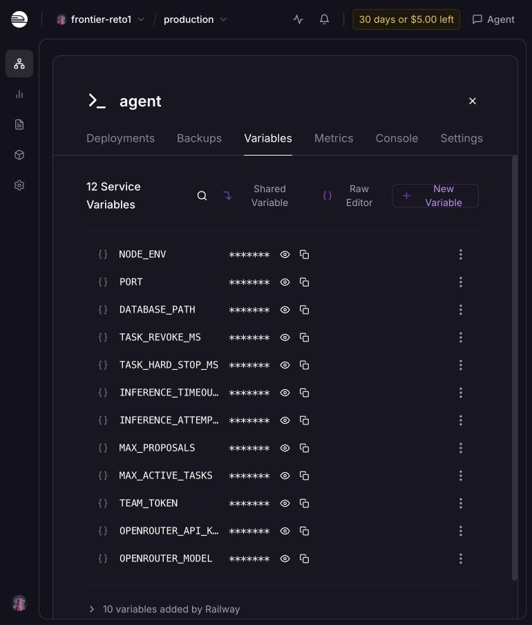
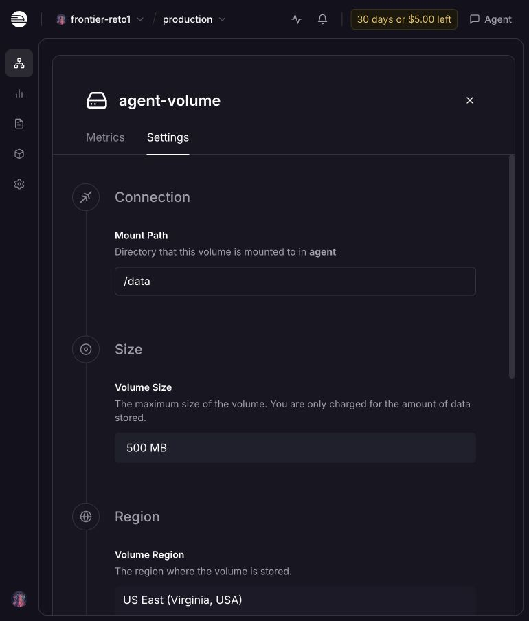

# Preparación del despliegue

10/10/2026, Bogotá. Preparación de infraestructura; el agente todavía no está desplegado para evaluación.

## Railway

- [Proyecto `frontier-reto1`](https://railway.com/project/fd637759-c5d9-4ed8-a0d3-c01a0ffac4d6?environmentId=177dbabd-dcd7-4be5-a3f3-94ea49bc78e6), entorno `production`.
- Servicio `agent`: `482b3289-6212-4361-896f-19f52ea93538`.
- Volumen `agent-volume`: `96e9c610-6c8d-4896-96bb-4bbcba6c2b76`, 500 MB, `/data`, US East (Virginia).
- Una réplica, serverless desactivado, On Failure con tres reintentos, overlap cero y draining diez segundos.
- Root directory `/frontier-reto-1/agent`; builder Dockerfile; ruta `/frontier-reto-1/agent/Dockerfile`; start command previsto `node dist/server.js`.
- Nueve variables de ejecución guardadas: `NODE_ENV`, `PORT`, `DATABASE_PATH`, `TASK_REVOKE_MS`, `TASK_HARD_STOP_MS`, `INFERENCE_TIMEOUT_MS`, `INFERENCE_ATTEMPTS`, `MAX_PROPOSALS`, `MAX_ACTIVE_TASKS`.
- Con autorización explícita del usuario se aplicaron `TEAM_TOKEN` y `OPENROUTER_API_KEY` del `.env` local. También se aplicó `OPENROUTER_MODEL=anthropic/claude-sonnet-5.5` del mismo archivo. La UI confirma doce variables sin cambios pendientes. No se enviaron valores de `PRACTICE_*`.
- Sin source ni deployment activo. No se generó dominio y no se alteró la autenticación de `/health`.

Detalles y valores no secretos: [RAILWAY.md](../../agent/RAILWAY.md).

## Verificación local

- 37 pruebas existentes, typecheck y compilación completados durante la preparación.
- Build Docker de la etapa `build` y de la imagen final completados.
- Imagen local `frontier-reto1:railway-runtime`: Node `v24.21.0`, SQLite abre/migra/inserta/lee/cierra en memoria, WebSocket disponible.
- Comprobación de contenido `/app`: sólo `dist`, `node_modules` y `package.json`. Contexto Docker excluye credenciales, bases y evidencia.
- `dist/server.js` ausente: no se probó ni se afirmó arranque HTTP.

## Pendientes para un entrypoint operativo

- Validar el modelo configurado con benchmark y completar servidor, supervisor y pruebas de aceptación.
- Conectar el código preparado al servicio; generar dominio público con target port 8080.
- Comprobar acceso HTTPS/WSS desde Railway. El dashboard confirma Limited Trial con restricciones de red saliente; resolver la verificación de la cuenta antes de la aceptación productiva.
- GitHub aparece sin conectar en [Account Settings](https://railway.com/account). La conexión gratuita para verificación está pendiente de autorización; no se concedieron permisos a repositorios.
- Comprobar persistencia con reinicio y parada de procesos durante reemplazo del deployment; probar las tres rutas desde internet con autenticación antes de entregar URL al evento.
